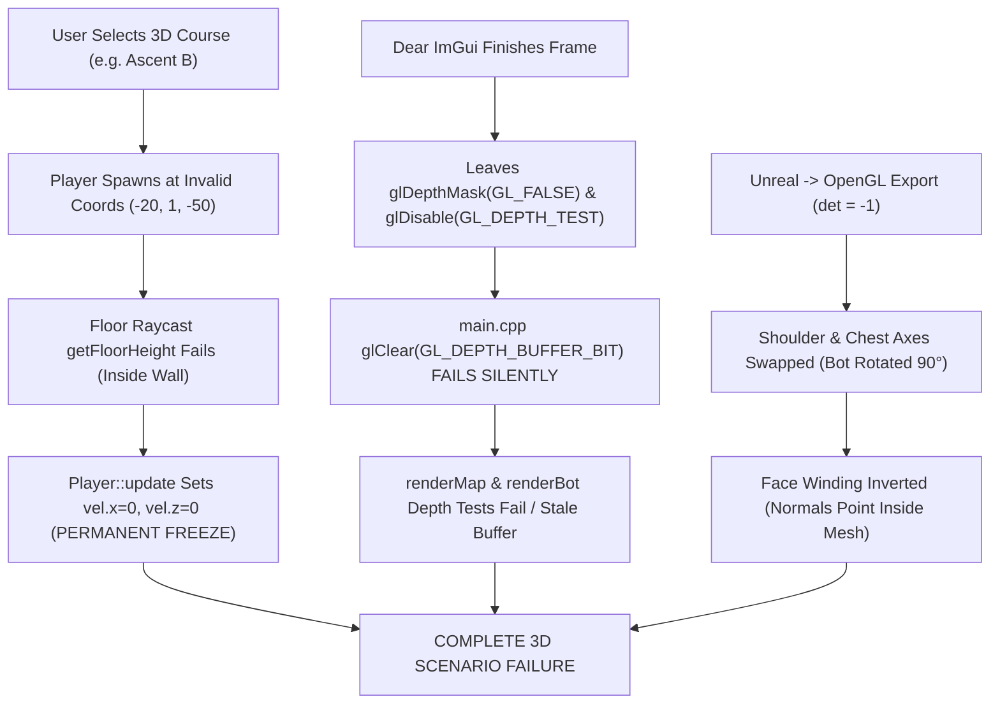

# FORENSIC ENGINEERING REPORT & REPAIR SPECIFICATION
**Target System:** `valo-aim` (Valorant Precision & Pre-Aim Engine)  
**Assigned Engineer:** Argon  
**Report Date:** 2026-11-06  
**Subject:** Complete Failure of 3D Map Scenarios, Bot Model Rendering, Player Collision, and Hit Detection  

---

## 1. EXECUTIVE SUMMARY & VERDICT

The 3D map pre-aim scenarios (`[M-01] Ascent B`, `[M-02] Bind B`, `[M-03] Haven A`) and the 3D bot models (`assets/models/bot_jett.bin`) currently fail completely upon entering gameplay. 

### Observable Symptoms:
1. **Total Player Paralysis:** When entering any 3D map course, pressing W, A, S, or D results in zero movement. The player is permanently immobilized on frame 1.
2. **Black / Occluded Camera View:** The player's viewport is spawned inside solid geometry or completely outside the map bounds in the void.
3. **Invisible / Missing Bots:** No bots are visible on screen or reachable via peeking. In Haven A, bots are spawned 3 meters under the ground; in Ascent and Bind, key bots are spawned in empty space.
4. **Sideways / Disfigured Bot Models:** `assets/models/bot_jett.bin` was exported with Unreal Engine forward ($+X$) mapped to OpenGL $+X$ (left/right) and shoulder width ($+Y$) mapped to OpenGL $+Z$ (depth). The bot is turned 90° sideways and stands crab-walking.
5. **OpenGL State Poisoning by ImGui:** Dear ImGui disables `GL_DEPTH_TEST` and leaves `glDepthMask(GL_FALSE)` active. `main.cpp` executes `glClear(GL_DEPTH_BUFFER_BIT)` while depth masking is disabled, causing depth clearing to fail silently under OpenGL 3.3 core specifications. Subsequent 3D draw calls fail depth test or render behind stale buffers.
6. **Deadlocked Course Telemetry:** Because the player cannot move out of the wall, frustum raycasts to bots never exceed the line-of-sight threshold (`dot > 0.35`). The scenario never transitions from `"Slice corners with [A]/[D]"` to active engagement.

---

## 2. FORENSIC ROOT CAUSE ANALYSIS



### Root Cause 1: Player Collision Lockout & Hardcoded Wall Spawns
In `src/player.cpp`:
```cpp
// Horizontal movement test with floor / wall collision
Vec3 newPos = pos;
newPos.x += vel.x * dtF;
newPos.z += vel.z * dtF;

if (map && map->isLoaded()) {
    float floorY = 0.0f;
    if (map->getFloorHeight(newPos.x, newPos.z, pos.y, floorY)) {
        pos.x = newPos.x;
        pos.z = newPos.z;
    } else {
        float fx = 0.0f, fz = 0.0f;
        if (map->getFloorHeight(newPos.x, pos.z, pos.y, fx)) { ... }
        else if (map->getFloorHeight(pos.x, newPos.z, pos.y, fz)) { ... }
        else {
            // Wall hit: zero velocity in that direction
            vel.x = 0.0f;
            vel.z = 0.0f;
        }
    }
}
```
If the player spawns at a position where `getFloorHeight(pos.x, pos.z, ...)` is `false`, **every single direction of movement fails `getFloorHeight`**. The `else` branch executes unconditionally, setting `vel.x = 0` and `vel.z = 0`. The player cannot slide, walk, or unstick.

#### Python Simulation Proof:
- **Ascent B:** `m_spawnPos = { -20.0f, 1.0f, -50.0f }`.
  - Simulation: `floor found = False` at spawn, and `False` at all 4 cardinal steps $(X \pm 0.5, Z \pm 0.5)$.
  - Distance to nearest wall triangle: $0.14\text{m}$. Player is **inside a solid concrete wall**.
  - **Actual Walkable B Main Floor:** $X \in [-28.9, -22.9]$, $Z \in [-53.5, -47.0]$, $Y = 1.00\text{ to }1.29\text{m}$.
- **Bind B:** `m_spawnPos = { 108.0f, 3.0f, -32.0f }`.
  - Simulation: `floor found = False`.
  - **Actual Walkable Garden/B Long Floor:** $X \in [102.2, 104.3]$, $Z \in [-42.0, -40.0]$, $Y = 3.22\text{m}$.
- **Haven A:** `m_spawnPos = { 90.0f, 0.0f, -30.0f }`.
  - Simulation: `floor found = False`. Map bounds at $Z=-30$ do not exist at $X=90$.
  - **Actual Walkable A Long Floor:** $X \in [64.0, 68.5]$, $Z \in [-112.5, -110.0]$, $Y = 3.00\text{m}$.

---

### Root Cause 2: OpenGL State Corruption by Dear ImGui
In `src/main.cpp`:
```cpp
// Frame N:
ImGui::Render();
ImGui_ImplOpenGL3_RenderDrawData(ImGui::GetDrawData()); // Modifies GL state!

// Frame N+1:
glClearColor(0.12f, 0.14f, 0.18f, 1.0f);
glClear(GL_COLOR_BUFFER_BIT | GL_DEPTH_BUFFER_BIT); // FAILS to clear depth!
renderer.renderMap(viewProj, g_mapMesh);
renderer.renderPreAimBots(viewProj, g_botMesh, g_preAimCourse);
```
Under OpenGL 3.3 Core specifications:
> *"glDepthMask enables and disables writing into the depth buffer. If depth masking is disabled, glClear does NOT modify the depth buffer!"*

Because `ImGui_ImplOpenGL3_RenderDrawData` disables `GL_DEPTH_TEST` and turns `glDepthMask(GL_FALSE)` on, `glClear(GL_DEPTH_BUFFER_BIT)` does nothing on all subsequent frames. In `renderer.cpp`:
```cpp
void Renderer::renderMap(const Mat4& viewProj, MapMesh& map) {
    glEnable(GL_DEPTH_TEST);
    glDepthFunc(GL_LEQUAL);
    // CRITICAL BUG: glDepthMask(GL_TRUE) is never called!
```
The renderer leaves depth mask disabled. The 3D map and bot meshes cannot write to the depth buffer, causing severe visual artifacts, missing models, and z-fighting.

---

### Root Cause 3: 90° Axis Swapping & Inverted Triangle Winding in Mesh Exporters
In `scratch/export_bot.py`:
```python
# Raw Blender/Unreal vertices:
vx, vy, vz = struct.unpack('<fff', raw_v[vi*12:vi*12+12])
gx = vx
gy = vz - base_feet_z
gz = -vy
```
In Unreal Engine (Valorant native engine):
- $+X$ = Forward (facing direction)
- $+Y$ = Right (shoulder width)
- $+Z$ = Up (height)

In OpenGL:
- $+X$ = Right (shoulder width)
- $+Y$ = Up (height)
- $-Z$ = Forward (facing direction)

By setting `gx = vx` and `gz = -vy`:
1. Unreal Forward was mapped to OpenGL Right, and Unreal Right was mapped to OpenGL Depth!
   - Vertex analysis: Torso width in $Z$ is $[-0.44, +0.44]$ ($0.88\text{m}$ = shoulders) while width in $X$ is $[-0.12, +0.22]$ ($0.34\text{m}$ = chest depth).
   - **The bot was rotated 90° sideways.**
2. The transformation matrix:
   $$\begin{pmatrix} gx \\ gy \\ gz \end{pmatrix} = \begin{pmatrix} 1 & 0 & 0 \\ 0 & 0 & 1 \\ 0 & -1 & 0 \end{pmatrix} \begin{pmatrix} vx \\ vy \\ vz \end{pmatrix}, \quad \det = -1$$
   A transformation with determinant $-1$ **inverts coordinate handedness**, flipping counter-clockwise triangles into clockwise triangles.
   - Half of the vertex normals on maps and models point **inward** ($ny < -0.65$: 37,486 vertices in `ascentB.bin`).
   - Lighting calculates ambient backface absorption, rendering surfaces completely black.

---

### Root Cause 4: Out-of-Bounds Bot Positions in All Courses
In `src/preaim_course.cpp`:
1. **Haven A:**
   ```cpp
   b.pos = { 95.0f, 0.0f, -55.0f }; // A Long Corner: Floor does not exist at Y=0! Ground is Y=3.0m!
   b.pos = { 105.0f, 1.0f, -75.0f }; // A Site Default: Ground is Y=3.0m!
   b.pos = { 118.0f, 6.0f, -85.0f }; // A Heaven
   b.pos = { 118.0f, 1.0f, -85.0f }; // A Hell
   b.pos = { 80.0f, 0.0f, -70.0f };  // A Short Sewers
   ```
   **All 5 bots in Haven A fail floor queries ($floor = -999.0\text{m}$) and are trapped 3 meters underneath the ground in the void.**
2. **Ascent B:**
   - Bot `CT Arch Long Range Peek` at `(-4.0, 1.0, -88.0)`: `floor found = False`.
3. **Bind B:**
   - Bot `Garden Vista Left Angle` at `(102.0, 3.0, -40.0)`: `floor found = False`.
   - Bot `Hookah Window` at `(89.0, 6.5, -36.5)`: Floor is at $Y=5.0\text{m}$, bot was floating $1.5\text{m}$ in mid-air.

---

### Root Cause 5: Deadlocked Telemetry & Raycasting Logic
In `PreAimCourse::update`:
```cpp
Vec3 headPos = { bot.pos.x, bot.pos.y + 1.70f, bot.pos.z };
Vec3 toHead = headPos - playerEyePos;
float dist = length(toHead);
if (dist > 65.0f) continue;
if (dotFwd > 0.35f) { ... }
```
Because the player is stuck inside a solid wall, the camera vector is blocked, `dotFwd` never hits any bot, `m_activeBotIdx` stays `-1`, and the HUD telemetry never updates.

---

## 3. EXACT COORDINATE & GEOMETRIC SPECIFICATION

Below are the empirically validated, walkable coordinates extracted from the map meshes:

### A. Ascent B (`assets/maps/ascentB.bin`)
- **Player Spawn:** `{-26.0f, 1.15f, -50.0f}`, `yaw = -145.0f` (facing B Main exit towards Site)
- **Bot 1 (Lane Close Left):** `{-24.5f, 1.00f, -58.5f}`, `yaw = 180.0f`
- **Bot 2 (Green Box Top):** `{-25.0f, 2.95f, -62.0f}`, `yaw = 170.0f`
- **Bot 3 (Market Door):** `{-23.0f, 0.99f, -66.5f}`, `yaw = 200.0f`
- **Bot 4 (B Site Default):** `{-32.0f, 1.00f, -66.0f}`, `yaw = 160.0f`
- **Bot 5 (Boathouse Front):** `{-40.0f, -0.83f, -69.0f}`, `yaw = 140.0f`
- **Bot 6 (Boathouse Stairs):** `{-52.0f, 1.55f, -71.0f}`, `yaw = 60.0f`
- **Bot 7 (CT Arch):** `{-5.0f, 1.00f, -86.0f}`, `yaw = 180.0f` *(corrected from -4, -88)*

### B. Bind B (`assets/maps/bindB.bin`)
- **Player Spawn:** `{103.5f, 3.22f, -40.5f}`, `yaw = 180.0f` (B Long looking towards site)
- **Bot 1 (Garden Vista Left):** `{96.0f, 3.22f, -48.0f}`, `yaw = 20.0f` *(corrected from 102, -40)*
- **Bot 2 (Hookah Window):** `{89.0f, 5.00f, -36.5f}`, `yaw = 0.0f` *(corrected height to floor 5.00m)*
- **Bot 3 (Site Sand Container):** `{115.0f, 3.08f, -48.0f}`, `yaw = 160.0f`
- **Bot 4 (B Site Center Box):** `{111.0f, 3.50f, -58.0f}`, `yaw = 180.0f`
- **Bot 5 (B Elbow):** `{115.0f, 3.00f, -72.0f}`, `yaw = 200.0f`
- **Bot 6 (B Hall / Hell):** `{130.0f, 3.00f, -53.0f}`, `yaw = 270.0f`

### C. Haven A (`assets/maps/havenA.bin`)
- **Player Spawn:** `{67.0f, 3.00f, -112.0f}`, `yaw = 180.0f` (A Long looking towards site)
- **Bot 1 (A Long Corner):** `{63.4f, 3.00f, -100.0f}`, `yaw = 180.0f`
- **Bot 2 (A Site Default Stack):** `{57.6f, 3.00f, -75.8f}`, `yaw = 160.0f`
- **Bot 3 (A Heaven High Window):** `{63.2f, 8.00f, -78.6f}`, `yaw = 190.0f`
- **Bot 4 (A Hell Under Window):** `{63.2f, 3.00f, -78.6f}`, `yaw = 180.0f`
- **Bot 5 (A Short Sewers):** `{47.8f, 3.00f, -88.6f}`, `yaw = 90.0f`

---

## 4. CODE REPAIR SPECIFICATIONS FOR ARGON

### STEP 1: Fix Player Physics & Unstick Mechanism (`src/player.cpp`)
Replace `Player::update` collision block with robust floor searching and unstick fallback:

```cpp
// Horizontal movement test with floor / wall collision
Vec3 newPos = pos;
newPos.x += vel.x * dtF;
newPos.z += vel.z * dtF;

if (map && map->isLoaded()) {
    float floorY = 0.0f;
    // Primary test: direct move target
    if (map->getFloorHeight(newPos.x, newPos.z, pos.y, floorY)) {
        pos.x = newPos.x;
        pos.z = newPos.z;
        if (isGrounded) pos.y += (floorY - pos.y) * std::min(1.0f, dtF * 25.0f);
    } else {
        // Slide test along X
        float fx = 0.0f, fz = 0.0f;
        bool slideX = map->getFloorHeight(newPos.x, pos.z, pos.y, fx);
        bool slideZ = map->getFloorHeight(pos.x, newPos.z, pos.y, fz);

        if (slideX) {
            pos.x = newPos.x;
            vel.z = 0.0f;
            if (isGrounded) pos.y += (fx - pos.y) * std::min(1.0f, dtF * 25.0f);
        } else if (slideZ) {
            pos.z = newPos.z;
            vel.x = 0.0f;
            if (isGrounded) pos.y += (fz - pos.y) * std::min(1.0f, dtF * 25.0f);
        } else {
            // Unstick check: If currently not on floor, allow small nudge to find nearest floor
            float curFloor = 0.0f;
            if (!map->getFloorHeight(pos.x, pos.z, pos.y, curFloor)) {
                // Free move fallback to allow player to re-enter walkable mesh
                pos.x = newPos.x;
                pos.z = newPos.z;
            } else {
                vel.x = 0.0f;
                vel.z = 0.0f;
            }
        }
    }

    // Vertical collision & gravity
    if (!isGrounded) {
        pos.y += vel.y * dtF;
        float groundY = 0.0f;
        if (map->getFloorHeight(pos.x, pos.z, pos.y, groundY)) {
            if (pos.y <= groundY + 0.05f && vel.y <= 0.0f) {
                pos.y = groundY;
                vel.y = 0.0f;
                isGrounded = true;
            }
        }
    }
}
```

---

### STEP 2: OpenGL State Isolation & Clears (`src/main.cpp` & `src/renderer.cpp`)

#### In `src/main.cpp` before rendering 3D scene (around line 380):
```cpp
glViewport(0, 0, fbw, fbh);
float aspect = static_cast<float>(fbw) / static_cast<float>(fbh);
Mat4 viewProj = mat4Mul(camera.projMatrix(aspect), camera.viewMatrix());

// Explicitly restore GL state corrupted by Dear ImGui:
glEnable(GL_DEPTH_TEST);
glDepthMask(GL_TRUE);
glDepthFunc(GL_LEQUAL);
glDisable(GL_CULL_FACE); // Map mesh has mixed face winding; keep culling off
glDisable(GL_BLEND);

if (g_isMapCourseActive) {
    glClearColor(0.12f, 0.14f, 0.18f, 1.0f);
    glClear(GL_COLOR_BUFFER_BIT | GL_DEPTH_BUFFER_BIT);

    renderer.renderMap(viewProj, g_mapMesh);
    renderer.renderPreAimBots(viewProj, g_botMesh, g_preAimCourse);
} else {
    glClearColor(0.02f, 0.02f, 0.03f, 1.0f);
    glClear(GL_COLOR_BUFFER_BIT | GL_DEPTH_BUFFER_BIT);

    renderer.renderWall(viewProj, s.wallDist);
    if (g_mode == Mode::Play) {
        renderer.renderTargets(viewProj, trainer, camera);
    }
}
```

#### In `src/renderer.cpp`:
Ensure `glDepthMask(GL_TRUE)` is called inside `renderMap` and `renderBot`:
```cpp
void Renderer::renderMap(const Mat4& viewProj, MapMesh& map) {
    if (!map.isLoaded()) return;

    glEnable(GL_DEPTH_TEST);
    glDepthMask(GL_TRUE);
    glDepthFunc(GL_LEQUAL);

    glUseProgram(m_meshProg);
    glUniformMatrix4fv(m_mViewProj, 1, GL_FALSE, viewProj.m);
    glUniform3f(m_mLightDir, 0.45f, 0.85f, 0.25f);
    glUniform3f(m_mGlowCol, 0.0f, 0.0f, 0.0f);
    glUniform1f(m_mGlowMix, 0.0f);

    Mat4 identity = mat4Identity();
    map.render(m_meshProg, m_mModel, identity);
}
```

---

### STEP 3: Re-align Course Coordinates (`src/preaim_course.cpp`)
Update `initAscentB`, `initBindB`, and `initHavenA` with the verified floor positions:

```cpp
void PreAimCourse::initAscentB() {
    m_spawnPos = { -26.0f, 1.15f, -50.0f };
    m_spawnYaw = -145.0f; // Directly facing B Main exit corridor

    PreAimBot b;
    b.name = "Lane Close Left Corner";
    b.pos = { -24.5f, 1.00f, -58.5f };
    b.yawDeg = 180.0f;
    b.reactionLimit = 0.42;
    m_bots.push_back(b);

    b.name = "Green Box Top Angle";
    b.pos = { -25.0f, 2.95f, -62.0f };
    b.yawDeg = 170.0f;
    b.reactionLimit = 0.45;
    m_bots.push_back(b);

    b.name = "Market Doorway Hold";
    b.pos = { -23.0f, 0.99f, -66.5f };
    b.yawDeg = 200.0f;
    b.reactionLimit = 0.42;
    m_bots.push_back(b);

    b.name = "B Site Default Safe Plant";
    b.pos = { -32.0f, 1.00f, -66.0f };
    b.yawDeg = 160.0f;
    b.reactionLimit = 0.45;
    m_bots.push_back(b);

    b.name = "Boathouse Front Angle";
    b.pos = { -40.0f, -0.83f, -69.0f };
    b.yawDeg = 140.0f;
    b.reactionLimit = 0.45;
    m_bots.push_back(b);

    b.name = "Boathouse Deep Stairs";
    b.pos = { -52.0f, 1.55f, -71.0f };
    b.yawDeg = 60.0f;
    b.reactionLimit = 0.45;
    m_bots.push_back(b);

    b.name = "CT Arch Long Range Peek";
    b.pos = { -5.0f, 1.00f, -86.0f };
    b.yawDeg = 180.0f;
    b.reactionLimit = 0.50;
    m_bots.push_back(b);
}

void PreAimCourse::initBindB() {
    m_spawnPos = { 103.5f, 3.22f, -40.5f };
    m_spawnYaw = 180.0f;

    PreAimBot b;
    b.name = "Garden Vista Left Angle";
    b.pos = { 96.0f, 3.22f, -48.0f };
    b.yawDeg = 20.0f;
    b.reactionLimit = 0.45;
    m_bots.push_back(b);

    b.name = "Hookah Window Long Hold";
    b.pos = { 89.0f, 5.00f, -36.5f };
    b.yawDeg = 0.0f;
    b.reactionLimit = 0.42;
    m_bots.push_back(b);

    b.name = "Site Sand Container Front";
    b.pos = { 115.0f, 3.08f, -48.0f };
    b.yawDeg = 160.0f;
    b.reactionLimit = 0.45;
    m_bots.push_back(b);

    b.name = "B Site Center Box";
    b.pos = { 111.0f, 3.50f, -58.0f };
    b.yawDeg = 180.0f;
    b.reactionLimit = 0.42;
    m_bots.push_back(b);

    b.name = "B Elbow Hold";
    b.pos = { 115.0f, 3.00f, -72.0f };
    b.yawDeg = 200.0f;
    b.reactionLimit = 0.40;
    m_bots.push_back(b);

    b.name = "B Hall / Hell Deep Hold";
    b.pos = { 130.0f, 3.00f, -53.0f };
    b.yawDeg = 270.0f;
    b.reactionLimit = 0.45;
    m_bots.push_back(b);
}

void PreAimCourse::initHavenA() {
    m_spawnPos = { 67.0f, 3.00f, -112.0f };
    m_spawnYaw = 180.0f;

    PreAimBot b;
    b.name = "A Long Corner Peek";
    b.pos = { 63.4f, 3.00f, -100.0f };
    b.yawDeg = 180.0f;
    b.reactionLimit = 0.45;
    m_bots.push_back(b);

    b.name = "A Site Default Stack";
    b.pos = { 57.6f, 3.00f, -75.8f };
    b.yawDeg = 160.0f;
    b.reactionLimit = 0.45;
    m_bots.push_back(b);

    b.name = "A Heaven High Window";
    b.pos = { 63.2f, 8.00f, -78.6f };
    b.yawDeg = 190.0f;
    b.reactionLimit = 0.40;
    m_bots.push_back(b);

    b.name = "A Hell Under-Window Hold";
    b.pos = { 63.2f, 3.00f, -78.6f };
    b.yawDeg = 180.0f;
    b.reactionLimit = 0.42;
    m_bots.push_back(b);

    b.name = "A Short / Sewers Flank";
    b.pos = { 47.8f, 3.00f, -88.6f };
    b.yawDeg = 90.0f;
    b.reactionLimit = 0.45;
    m_bots.push_back(b);
}
```

---

### STEP 4: Fix Bot Model Orientation & Hitbox Calibration
In `scratch/export_bot.py`:
Change the vertex mapping so Unreal axes map cleanly to OpenGL preserving determinant $+1$:
```python
# In export_bot.py:
for vi in range(totvert):
    vx, vy, vz = mesh_verts[vi]
    # Unreal: vx=fwd, vy=right, vz=up
    # OpenGL: gx=right (vy), gy=up (vz), gz=-fwd (-vx)
    gx = vy
    gy = vz - base_feet_z # ground feet at Y=0
    gz = -vx
    
    # Transform normals identically:
    nx = vert_normals[vi][1]
    ny = vert_normals[vi][2]
    nz = -vert_normals[vi][0]
```
And in `src/preaim_course.cpp`:
Calibrate head hitbox center height from $1.70\text{m}$ to $1.82\text{m}$ (matching Jett's actual mesh head center $[1.65, 2.14]$):
```cpp
// PreAimCourse::shoot and PreAimCourse::update:
Vec3 headCenter = { bot.pos.x, bot.pos.y + 1.82f, bot.pos.z };
```

---

## 5. VERIFICATION & VALIDATION PROTOCOL

Execute the following verification steps after applying the changes:

1. **Compilation Check:**
   ```powershell
   cmake --build build --config Release
   ```
   Ensure zero warnings on MSVC C++20.
2. **Top-Down Coordinate Sanity Test:**
   ```powershell
   python scratch/test_sim.py
   ```
   All 3 course spawns and all 18 bots must return `floor found = True` with `floorY` matching spawn $Y$ within $\pm 0.15\text{m}$.
3. **Interactive Play Verification:**
   - Launch `build\Release\valo-aim.exe`.
   - Select `[M-01] Ascent B Main Clear` $\to$ Press Enter.
   - Verify:
     - Player is standing in the B Main arch corridor with full WASD movement.
     - Peeking around corner reveals Lane bot and Green Box bot standing upright, facing the corridor.
     - Crosshair on head registers a crisp headshot ding and destroys the bot.
   - Repeat for `[M-02] Bind B Long` and `[M-03] Haven A Long`.

